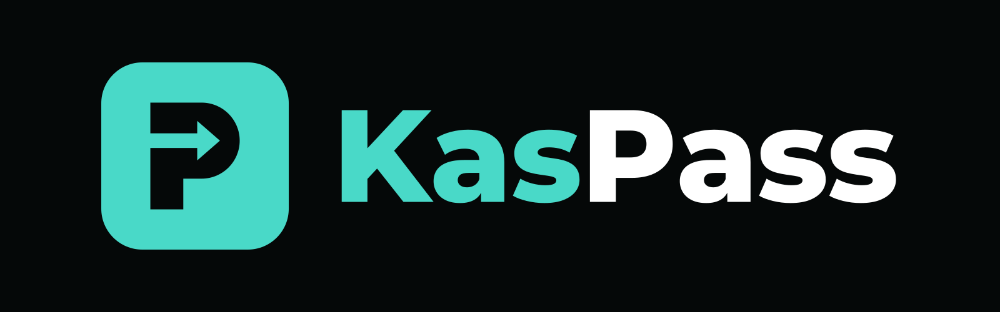

<p align="center">
  
</p>

<p align="center"><b>Creator memberships on Kaspa, enforced by L1 covenants.</b></p>

> ⚠️ **New software, not audited.** It runs on mainnet for one creator while the code is reviewed in public; everything else runs on testnet. Use it with real KAS only if you accept that.
>
> Built with AI assistance (Claude). See [SECURITY.md](SECURITY.md) for the known limits.

## What is KasPass?

Today, creators sell memberships through platforms that take a cut, hold the money, own the customer list, and can change the rules or shut you out at any time.

KasPass puts the membership itself on Kaspa. A creator launches a membership, fans buy a pass that lives in their own wallet, and the rules are enforced by the Kaspa base layer, not by a company or server:

- **Paid straight to the creator.** Every purchase, renewal, and upgrade pays the creator's own payout vault directly.
- **Monthly or lifetime.** A membership can sell recurring passes, lifetime passes, or both.
- **Upgrade with credit.** Monthly members can upgrade to lifetime; if the creator enables it, what they've already paid counts toward the price.
- **Free trials.** Creators can hand out short free passes that renew straight into paid ones, or let members start a free trial themselves (see [Self-serve free trials](#self-serve-free-trials)).
- **Prices you can change, rates members keep.** Creators can raise prices or run sales for new buyers any time. Every pass locks in the rate it was bought at, so early supporters keep their deal.
- **Limited supply, if you want it.** Cap a membership at, say, 100 founding members. The cap is enforced on-chain and counts every pass the plan issues, trials included, so a plan with a cap can't offer self-serve trials.
- **Resell or not, creator's choice.** Resellable memberships pay the creator a royalty on every transfer; locked memberships keep passes with the buyer.
- **Can't be forged.** Every genuine pass carries its membership's covenant ID. Kaspa consensus refuses any pass that wasn't issued by the membership itself.
- **Optional privacy.** A pass can be held by a separate pass key instead of a main wallet. Full zero-knowledge membership proofs are on the roadmap.

Apps check one thing: *does this address hold an unexpired KasPass for this membership?* If yes, unlock the content.

## Status

✅ **v5 contracts** in [SilverScript](https://github.com/kaspanet/silverscript) 1.0 for Kaspa's Toccata covenants: `contracts/minter_v5.sil` (and `minter_v5t.sil`, the same with self-serve trials), `membership_v5.sil`, `owner_record.sil`, `vault.sil` and `payin.sil`. Older versions (v2, v3 and v4) are retired: the program builds and reads v5 memberships only.
✅ **Live on Kaspa mainnet** since Nov 2, 2026, behind a partner's membership checkout, and on Testnet-10 at kaspass.app.
✅ **Fee can't be skipped**: in simulation, the contracts refuse a fee 1 sompi short, a fee sent elsewhere, a missing fee, swapped outputs and an underpaid creator.
✅ **Indexer, web API and JavaScript SDK**: rebuilds every pass from the chain alone and proves each one before reporting it.
✅ **Website with wallet sign-in** (Kaspire, on a computer or on a phone over WalletConnect), buying, renewing, upgrading, auto-renew, gifts, free trials, pay-from-any-wallet QR codes, and a creator dashboard.

## How it works

Every membership is a few small contracts that share one covenant family.

**Owner record** (`contracts/owner_record.sil`): one per creator. It names the creator's owner wallet and a separate recovery wallet. Creator actions (price changes, trials, server-key changes) need the record; the recovery wallet can hand it to new wallets.

**Payout vault** (`contracts/vault.sil`): every payment goes here, and only the owner record's current owner can withdraw.

**Minter** (`contracts/minter_v5.sil`) is the only way into a membership. Each Minter output is a *sales lane* holding the current prices (as KAS ceilings) and remaining supply.

| Action | Who | What it does |
|---|---|---|
| `buy` | anyone | Monthly pass at today's price |
| `buy_lifetime` | anyone | Lifetime pass at today's lifetime price |
| `buy_term` | anyone | Commitment pass: several periods paid up front |
| `trial` | creator (owner record) | Free trial pass; counts toward the supply cap |
| `set_prices` | creator (owner record) | New ceilings for new buyers |
| `set_voucher` | creator (owner record) | Trust a new server key |
| `fork` / `retire` | creator | Split a lane in two, or close one; existing passes are unaffected |

**Membership** (`contracts/membership_v5.sil`) is one per pass. It carries its owner, expiry, the rates locked in when it was bought, and any prepaid balance.

| Action | Who | What it does |
|---|---|---|
| `renew` | anyone (gifts work) | Pay today's price, extend the expiry |
| `autorenew` | the server's keeper | Renew from the pass's prepaid balance near the end of a period |
| `deposit` / `withdraw` | anyone / owner | Top up the prepaid balance, or take it back |
| `upgrade` | anyone | Switch to lifetime at the locked price, minus past payments if credit is on |
| `transfer` | owner | Resellable memberships only; creator gets a royalty |
| `close` | owner | End the pass, get the refundable bond (and balance) back |
| `rekey` | creator (owner record) | Move a pass to a new server key |

**Prices.** A plan is priced in CAD, USD, EUR or KAS. The contract holds a KAS ceiling (for a currency, 3 times today's amount unless chosen otherwise), and the server signs each purchase and renewal down to today's price. With no fresh exchange rate, nothing is sold and auto-renewals wait.

**Permanent at launch:** period length, trial length, resellable and royalty, prepay cap, bond, supply cap, protocol fee.

Each payment must sit in the output directly after that pass's own successor, so several passes renewed in one transaction can never share a single payment. Times are Unix milliseconds using SilverScript's `temporal` type.

### Protocol fee

- **2% of each payment**: sales, renewals, upgrades and resale royalties. Free trials and closes pay nothing.
- **Taken from the creator's share**, not added on top: a 200 KAS pass pays 196 KAS to the creator and 4 KAS to KasPass. The buyer pays the same price either way.
- **Skipped when tiny.** Fees under 0.5 KAS aren't charged, because very small outputs are costly under Kaspa's storage-mass rules (KIP-9). At 2%, that means payments under 25 KAS pay no fee.
- **Enforced by the contracts**, at the fee address fixed when the membership launched. A site started with `--no-fee` launches memberships without one.

### Auto-renew and holder discounts

- **Auto-renew from a prepaid balance.** In the last part of each period (a third of it by default, at most 3 days), the server's **keeper wallet** renews the pass from its own balance at today's price, paying only the network fee. Members can top up any time and **cancel** any time by taking the rest back; their access stays until the current period ends. On plans priced in a currency, the member picks a cushion for prepaid renewals in case KAS falls: none, 10% (the default) or 25% (`cushion_pct` on `/v1/buy/prepare` and on a `deposit` in `/v1/pass/prepare`); plans priced in KAS need none. If the balance doesn't cover a renewal when it's due, nothing is charged: `/v1/check` shows `auto_renew: "not_enough_balance"` with `renewal_due_sompi`, the member gets one Telegram or Discord message, and a top-up before the end date lets it renew (`lapsed_reason: "not_enough_balance"` if it ends that way). The page calls this "Prepay future months (auto-renew)" and shows the balance in a "Renewal balance" box.
- **Holder discounts.** The creator sets a holder discount in the dashboard. Members who qualify in the holder club right now pay that much less, on purchases and at every renewal.

The server's voucher key and keeper wallet are created on the server the first time it starts (in `keys/`, readable only by the server's account) and never leave it. The dashboard shows the keeper's address and balance; send it a little KAS for network fees.

## Indexer, API and SDK

Any app can ask one question: *does this address hold an active pass?*

**Membership card.** Launching a membership writes `tier-card.json`: the covenant ID, the creator's address, the permanent settings, and where the membership starts on-chain. It contains no keys and is safe to publish. It's also self-checking: a card with any wrong setting simply matches nothing.

**Indexer.** Starting from the card, it walks the chain and reads every spend of a KasPass contract. Each spend reveals the old pass state and the action taken, so the indexer computes the exact new pass. A pass is only reported if:

1. an output carries this membership's covenant ID,
2. that output's script hash equals the one computed from the pass terms, and
3. that exact coin is still unspent on-chain right now.

So an indexer can't invent or alter a pass, and anyone can run their own from the membership card.

**Web API** (`membership-cli serve`, port 8787 by default):

| Endpoint | Returns |
|---|---|
| `GET /v1/health` | Sync status and counts |
| `GET /v1/tier` | The membership card |
| `GET /v1/passes` | Every live, verified pass |
| `GET /v1/check?address=...` | `{ address, active, passes, levels }`: active on any level (each pass says its level) |
| `GET /v1/member?address=...` | Everything in `/v1/check`, plus per pass `renew_opens_ms`, `renews_from_ms`, `renewal` (`currency`, `amount`, `kas_today`) and `periods_prepaid`, and the wallet's `payments` (`time_ms`, `kind`, `kas`, `txid`, `level`) and `payin_orders` (`level`, `status`, `txid` and `refunds`; an open order's pay-in address `pay_to` and `created_ms` only when signed in as that wallet): for a partner's "Membership" page. Public, like `/v1/check`; no currency amounts for past payments |
| `GET /v1/page` | The page's tagline, intro, links, default view, member count (if shown) and each level's description |
| `GET /v1/levels` | Every level on sale, lowest first, with its name, perks, offer, `rank`, `access_rank` payout `vault` and `keeper`, plus the club name and the word for levels |
| `GET /v1/promo` | The running holder promotion, if any: `active`, `label`, `level`, `requirement` (in words), `needs`, `start_ms`, `end_ms`, `claims_left` |
| `POST /v1/promo/check` | `{ session }` → does the signed-in member qualify (`eligible`, `reason`, and what each requirement found) |
| `POST /v1/promo/claim` | `{ session }` → the keeper sends the member's free pass; returns the `txid` |
| `GET /v1/addresses` | Every fixed address the site's memberships use: each level id (the covenant id on its sales lanes and passes), the `vault`, the KasPass `fee_address` and `fee_bps` (when there's a fee), the deposit, and the `keeper` wallet |
| `GET /v1/nonce` | A one-time sign-in challenge |
| `POST /v1/login` | `{ address, message, signature }` → verified membership and a session |
| `POST /v1/logout` | Ends the session in the `x-kaspass-session` header on the server (the pages call it on Sign out) |
| `GET /v1/members` | Members-only content, only while the pass is active (session in the `x-kaspass-session` header) |
| `GET /v1/offer` | Current prices and supply (when this server sells passes) |
| `POST /v1/buy/prepare` | `{ address, kind }` → a purchase for the buyer's wallet to sign (needs a session for `address`) |
| `POST /v1/pass/prepare` | `{ address, txid, index, action, to? }` → renew, upgrade, deposit or withdraw (anyone may pay for a renewal), or close or transfer it (owner only); needs a session for `address` |
| `POST /v1/submit` | `{ quote, psktTransactionJson }` → checked and broadcast (also at `/v1/buy/submit`) |
| `GET /` | The KasPass website |

With several levels on sale, every endpoint takes `?level=<covenant id, or its first 12 characters>`; without it, the lowest level is used (and `/v1/check` looks at all of them).

**`rank` and `access_rank`.** `rank` is a plan's place in the list (0 = lowest). `access_rank` is what it unlocks: plans that give the same access share one. In the dashboard, tick "Same access as …" on a plan to make it give the same access as the plan right above it, for example a monthly plan under a yearly one. The monthly plan still sits below, so moving up to the yearly plan is an upgrade with a credit. With nothing ticked, `access_rank` equals `rank`. Partner sites should gate on `access_rank` (or the level id), never on `rank`. Each pass in `/v1/check` also carries `access_rank` and its own plan's `period_ms`.

**Your own look.** Dashboard › Settings › Look and brand makes the membership page (and Help) look like the creator's own website: colors with an optional dark version (visitors get the one matching their device), any Google Font, corner style, logo (also the tab icon), profile photo, banner and a "Back to my website" link. A slim "Memberships by KasPass" line stays at the top and bottom. "Match my website" reads the creator's site for colors, fonts and a logo and fills them in as suggestions; nothing changes until Save.
- Fonts are downloaded from Google once, when saved, and served from the site itself, so visitors never contact Google. Font names can only hold letters, numbers and spaces; only real woff2 files are kept.
- Pictures must be real PNG, JPEG or WebP files, or SVGs with no scripts, event handlers, links or embedded content. They're served with a policy that blocks anything active.
- "Copy from my website" is creator-only and only reads the site's own website (its return origins when set), over https, never private or internal addresses (checked, then pinned), at most 2 MB, with a short timeout and same-site redirects only. It never runs anything from the page.
- Colors are checked as `#rrggbb` and must be readable (text at least 3 : 1 against its background; the dashboard warns below 4.5 : 1).
- `GET /v1/brand` gives the look as JSON; `/brand/theme.css` and `/brand/fonts.css` are what the pages load.

**Tax-year names.** A plan's name, perks and description can include `{tax_year}`: members see the tax year on sale now, which moves on every November 1 (Pacific time). `{next_tax_year}` is the year after. So "Kaspa Vision + KasTax {tax_year}" reads "… 2026" from Nov 1, 2026 to Oct 31, 2027, then "… 2027". Names live on the site, not in the plan's contract, so renaming never changes the level id. The dashboard keeps showing the text as written.

**KAS ceiling (v5).** A plan priced in a currency stores a KAS ceiling: the most KAS a purchase or renewal can ever charge. It's 3 times today's KAS amount unless the launch form says otherwise (1.5 to 10 times), and it can't change after launch.

**SDK** (`sdk/kaspass.js`):

```js
import { hasActivePass } from "./kaspass.js";
if (await hasActivePass("http://127.0.0.1:8787", address)) unlock();
```

Before unlocking anything private, an app must also confirm the visitor controls the address. `/v1/check` alone only says what an address holds, and anyone can type in someone else's address.

## Website and wallet sign-in

`membership-cli serve` also serves the KasPass website at `http://127.0.0.1:8787/`.

1. **Connect.** The page asks the [Kaspire](https://kaspire.kaslab.space) extension for your address and checks you're on the membership's network.
2. **Sign.** The server hands out a one-time nonce, and your wallet signs a short message (KIP-5) naming the site, your address, and that nonce. Signing is free and sends no transaction.
3. **Verify.** The server checks the signature against your address, and refuses it if it was made for a different site, a different address, or reuses a nonce (nonces work once, within 5 minutes).
4. **Unlock.** If the indexer shows an active pass for that address, the members area opens. Access is re-checked on every request, so an expired pass loses access right away. Sessions last one hour.

**Buying.** Signed-in visitors without a pass see **Buy monthly** and **Buy lifetime**:

1. The server builds the whole purchase: the membership's sales lane, the buyer's coins, the new pass, the payment to the creator, and change.
2. Kaspire receives it with `signPskt`, rebuilds it independently, checks the exact hash it will sign, and shows every amount. It signs only the buyer's own coins. The sales lane needs no signature, because the Minter covenant itself enforces the price.
3. The server puts the signatures into its own copy, runs every input through Kaspa's script engine under its committed limits, and broadcasts. Nothing else from the wallet's reply is used, so a changed transaction simply fails the check.

**Every output labelled.** Kaspire writes its own review of each transaction, and websites can't change that text, by design. It lists outputs by number and address only. So before Kaspire opens, the page shows the same numbered outputs with plain labels ("To the creator", "KasPass fee (2%)", "Your new pass (contract)", "Change back to you") and exact amounts, so buyers can match them line by line.

**Plans priced in a currency (v5).** The page puts the signed-in wallet first ("Signed in as …", "Your plan: …, until …"). Each plan card shows what *this* wallet pays, from `/v1/quote`: the crossed-out regular price, a Founding badge, about how much KAS today, any upgrade credit, and a button that names the action and amount ("Buy for CA$200", "Upgrade for CA$100.21", "Renew for …"). Pressing it opens one pay box right under that card: what you get, what you pay now in KAS and the currency, next year's price, the 1 KAS deposit and auto-renew, then "Pay … KAS in Kaspire". After paying, a done screen at the top says what you now have and until when, with the partner site's return button (`?return=`) and, after an upgrade, a note that closing the old pass returns its deposit. Pass details fold underneath. Plans priced in KAS keep the layout below.

**Kaspire mobile (WalletConnect v2).** Next to "Sign in with Kaspire" there's "Use Kaspire mobile". On a computer it shows a pairing QR for the Kaspire app; on a phone it opens the app. The app signs the same KIP-5 sign-in message (`kaspa_signPersonal`) and the same transactions (`kaspa_signPskt`, without the extension-only `sender` field), so the server side is unchanged. The WalletConnect library (`@walletconnect/sign-client` 2.21.8, the last Apache-2.0 release) is bundled as `web/walletconnect.js` and loads only when the button is pressed; telemetry is off. The page may connect to WalletConnect's relay (`wss://relay.walletconnect.org`) and verify service, which the Content-Security-Policy allows. The Reown project id is public and limited to the site's domains.

**Pay from any wallet (QR code).** On plans priced in a currency, the pay box also offers "Pay from another wallet (QR code)", for KAS that sits in a phone wallet, Tangem or an exchange. The pass goes to the signed-in wallet; the money can come from anywhere.

1. The server makes a one-time **pay-in address** for the order (`POST /v1/payin/order?level=…` with `{address, action: "buy"|"renew", periods}`) and the exact amount: today's price, the deposit, any prepaid auto-renew, and 1 KAS for the network fee (what isn't used comes back). The page shows it as a `kaspa:…?amount=…` QR code, valid for 15 minutes.
2. The pay-in address is a small contract (`contracts/payin.sil`). Its coins can only go two ways: into a purchase or renewal on that plan that leaves a pass owned by the signed-in wallet, with the rest back to that wallet; or, after the refund time (1 hour), back to that wallet. Nobody holds the money in between, the server included.
3. A background job watches open orders. When a payment lands, it completes the purchase within seconds (signed by the server's voucher key, like any purchase at today's price). A payment that's too small, too late or extra goes back automatically after the refund time.
4. The page polls `GET /v1/payin/order?id=…` and shows the done screen when it's through. Orders are kept in `payin-orders.json`.

It's on for test networks only. On mainnet it stays off, with no switch, until a fixed version of the pay-in contract is out (see [SECURITY.md](SECURITY.md)).

**Renew and upgrade.** Signed-in members see **Renew** (at their locked rate) and **Upgrade to lifetime** (with credit, if the membership offers it). These work exactly like buying: the pass contract needs no signature, so the member's wallet signs only its own coins. Renewals open once the time left is within the membership's prepay limit, and the page uses the chain's clock, not the visitor's.

**Close.** Owners can end a pass and get its bond back. This is the one action that needs the owner's signature *inside* the pass contract: the server sends Kaspire the complete unlock script with a blank 65-byte slot and the exact hash to sign, and Kaspire fills the slot after checking that hash itself. A close signed by anyone but the owner fails the contract and is refused before anything is sent.

**Transfer.** On resellable memberships, owners can send a pass to another wallet. Like Close, the owner signs inside the pass contract; their wallet also pays the creator's royalty (and the protocol fee on it). The pass keeps all its terms. A wallet that already has an active pass can't receive another.

**One pass per wallet.** The website won't sell a new pass to a wallet that already holds an active one, or that bought one in the last two minutes (so a second tab or a double click can't buy twice). A wallet with an expired pass is offered Renew instead, which keeps its locked rate. Gifts from the dashboard check the same thing.

**Runs from the membership card alone.** To show passes and prices, the website needs nothing private: no `state.json`, just the public `tier-card.json`. (Selling at a currency price, auto-renewal and promotions also use the server's voucher key and keeper wallet, below.) The indexer finds the membership's current sales lane and prices on the chain, because every sale reveals the lane's state, and it follows the lane through sales and price changes. The card records where the lane was when it was written, which only matters until the first sale. So anyone can host a KasPass site for a membership, and price changes show up on the website by themselves.

## Creator dashboard

`http://127.0.0.1:8787/dashboard`. The creator signs in with the wallet that created the membership. The pages use plain words for the parts described here: the keeper wallet is the **fees wallet**, the recovery wallet is the **backup wallet**, setting up the owner record is **Turn on payouts**, and closing a pass is **ending a membership**. What the site sells is called a **plan** unless the creator picks another word (tier, level). The dashboard has these tabs: **Overview** (the numbers, what's left to set up, the latest activity), **Your page**, **Levels**, **Members**, **Prices & sales** (for the plan picked at the top), **Promotions** (holder promotion, holder discount and the keeper wallet, for all plans), **Groups**, **Payouts** and **Settings** (`/dashboard#prices` opens a tab directly, `/dashboard#all` shows everything on one page). It covers:

- **Overview**: what they've earned (to their wallet, after the KasPass fee), active members, passes sold, renewals, upgrades, trials, and fees paid. All of it is read from the chain.
- **Who can see your page** (Settings tab): everyone, or only people with a private link (`?k=...`; a cookie remembers them after the first visit). Others get "This page isn't public" (404, noindex). On KasPass's own site this also hides the demo links and section on the home page. `page-private.json`.
- **Alerts** (Settings tab): a direct message from the site's Telegram bot (or Discord) when someone gets a pass, and optionally on upgrades and renewals. It reads the chain, so purchases made anywhere count (the page, QR payments, gifts, promotion claims). **Connect my Telegram** links the owner's chat; old sales are never re-sent (`alerts.json`, `alerts-seen.json`). Needs a bot token in `telegram.token` next to the membership card.
- **Kaspire mobile**: on a phone, the dashboard signs in and approves every action through the Kaspire app (WalletConnect); on a computer it's offered next to the extension. If the app's active wallet changes, the page drops the old connection and offers Reconnect.
- **Change prices** for new buyers, approved in Kaspire through the owner record; existing passes keep their own terms.
- **Give a pass**: a free trial (the creator funds only its refundable bond), or a monthly or lifetime pass the creator pays for, for giveaways, staff, or someone who paid another way.
- **Members** and **Activity**: every live pass, and every sale, renewal, upgrade, trial and royalty, with the creator's share and the fee.
  - Each member shows their .k and .kas names (primary first) and wallet, and who paid ("The member", the creator's wallet for a gift, or "Keeper (promotion)").
  - A pass only names its owner by a hash of their key, so the site remembers the wallet behind it whenever it meets it: a sign-in, a purchase or gift made on the site, a QR order, a promotion claim, or a linked wallet (`member-addresses.json`). Until then the row says "Wallet not seen yet".
  - **Your note**: a private note per member ("Alex from Discord"), saved as you type (`member-notes.json`). It follows the member across plans and is never shown to anyone else.
- **Launch a new membership**: the site's owner (the owner record's wallet) launches new levels. Each membership card is saved next to the website.
- **Names and wording**: the creator's display name, the membership's name, and the word for what members hold ("membership" by default, or "pass", "subscription", anything in letters). The membership page, renewal reminders and auto-renew messages all use them, so a creator selling a "season ticket" never shows "No active pass". Two more names in **Settings** cover a site with levels: a **club name** for the whole group (for example "Executive Club", shown as the page title with "by" and the creator's name) and the **word for the levels** ("level" by default, or "tier", "plan", and so on), which the dashboard and the membership page use ("Add a tier", "Choose your tier").
- **Several paid levels**: tick more than one membership in **Memberships on this site** and they're sold side by side as levels (for example Bronze, Silver and Gold), lowest first, saved in `levels.json`. Each level includes the perks of the levels below it: its Telegram groups (`/kaspass Gold` in a group means Gold and higher) and Discord roles (one per level, plus Pass Holder for any paid level). A level picker at the top of the dashboard chooses which level the other panels manage, and each level gets a short list of what it includes, shown on its card. Members can hold one level and buy another; the page then offers to close the old one and return its deposit and unused balance. All levels on a site must be the same creator's.
- **Your page**: the names members see, a one-line tagline, an intro written in a small formatting editor (bold, italic, underline, headings, lists, quotes, links; pasted text comes in plain so every page keeps one clean look), links (website, X, TikTok, YouTube, Instagram, Telegram, Discord), an optional member count, and whether levels show first as **cards** or a **comparison table**. Visitors can switch views and their choice is remembered. Long intros fold with "See more".
- **A description for each level**, written with the same editor in the Levels tab (or when adding a level). The membership page shows it when someone picks that level, above its prices. Formatted text is kept to that short list of tags and cleaned on the server ([ammonia](https://crates.io/crates/ammonia)) and again in the page, so nothing pasted can run scripts or load anything on members' pages.
- **Add a level**: in the Levels tab, give the new level a name and what it includes, set its prices and create it. It is named before it goes on sale, and one click adds it to what you sell.
- **Help where you need it**: every setting has a "?" tip, prices that don't make sense for buyers get a warning before you sign (for example a commitment plan that costs more than lifetime), and each level lists what was **set when it was created** (billing period, free trial, deposit, supply, resale, auto-renew window, largest holder discount). Those are written into its contracts and can't change; to offer different ones, add a new level.
- **Commitment plans**: one payment up front for several billing periods (for example 12 months for the price of 10). Not refunded if a member leaves early; afterwards the pass renews at the monthly price.
- **Memberships on this site**: every membership launched here. Tick the ones to sell and save (one ticked is a single membership, as before). Right after a launch, **Make this the live membership** or **Add it as a level** does it in one click. Only the creator of the membership that's live now can switch, so someone launching their own membership on your site can't take it over. The choice is saved in `active-card.txt` (it wins over `serve --card`) and the site restarts itself to load it (under systemd, which brings it back within seconds; run by hand, restart it yourself). Passes on the other memberships stay on-chain, and switching back works the same way.

**Security settings for `serve`:**
- Pages, scripts and fonts are all built into the program. Nothing is loaded from other sites, and nothing on the server's disk can change what visitors run.
- Every response carries a strict Content-Security-Policy (no inline scripts, nothing from other sites) plus nosniff, `X-Frame-Options: DENY` and `Referrer-Policy: no-referrer`. `--csp report` makes browsers only warn instead of block, and `--csp off` leaves the policy out.
- Any website may read the public API with GET. A POST carrying another site's `Origin` is refused, so other websites can't act for a signed-in visitor.
- Rate limits apply per visitor, using the address the reverse proxy (Caddy) forwards:
  - reads: bursts of 240, then 4 a second;
  - sign-ins and anything that changes something: bursts of 30, then one every 2 seconds.
- `--creator-only-launch` lets only the site's creator wallet launch new levels from the dashboard. Use it on a production site.
- Build with `cargo build --release --locked`, so the exact dependency versions in `Cargo.lock` are used.

**v5: prices in a currency, a payout vault, and a recovery wallet:**
- In the dashboard's Payouts tab, the creator sets up an **owner record** once: their wallet as owner, plus a separate recovery wallet (a paper-only wallet is fine).
  - From then on, new memberships are v5:
    - every payment goes to a **payout vault** the owner withdraws from;
    - prices are set in **CAD, USD, EUR or KAS**;
    - buyers pay today's price in KAS (Kraken rates, refreshed every minute).
  - The contract holds a KAS ceiling of 3x today's amount; the server signs a discount off it for each purchase and renewal. A plan priced in KAS has no ceiling above its price and needs no exchange rate.
- **Lifetime and commitment prices:** a v5 plan can offer a lifetime price and a commitment (2 to 120 periods paid up front), each in the plan's currency with its own KAS ceiling. Changing the monthly ceiling keeps them.
  - "Upgrade to lifetime" on a held pass is offered only on plans priced in KAS: the contract charges the lifetime price locked into the pass, which on a currency plan is its ceiling.
- **Free trials:** the owner gives trial passes from the dashboard, approved through the owner record. Trials earn no upgrade credit.
  - With no fresh rate, nothing is sold and auto-renewals wait instead of charging the ceiling.
- **Optional founding price:** a first-purchase price until a set moment.
- **Upgrade credit:** buying a higher level credits the unused part of a lower one's current period, at what was paid for it (at most one period at that level's regular price).
- **Price display:** the creator chooses whether visitors see the plan's currency or an approximate price in their own.
- **Handover:** the recovery wallet can hand the owner record to new wallets. Existing passes keep paying the same vault, and members do nothing.
- **Price steps:** discounts off the ceiling are in millionths, capped at 99.99%, so even a large rise in KAS keeps prices within a cent or so. The server always rounds so a buyer pays a hair more than the plan's price, never less.
- **Changing the ceiling:** Prices tab, "Highest KAS price (ceiling)". One approval; never below today's price. Each pass keeps the ceiling it was bought with.
- **Replacing the server key:** the key that signs today's price lives in each plan and pass, not in the contract code. If it may have been exposed, the owner clicks "Replace server key" (Payouts tab). New plans trust the new key at once; "Move to the new key" then moves existing plans and passes over, several per approval, through the owner record. Members do nothing. The new key is saved as `keys/voucher-2.key` (then `-3`, ...).
  - Moving many passes per approval needs the fee paid from a small coin, so the first approval may set aside 2 KAS in the owner's own wallet (it stays theirs).
- **Price quote for a wallet:** `GET /v1/quote?address=kaspa:...&level=<id>` (read-only, builds no transaction). It returns `action` (`buy`, `upgrade`, `renew` or `own`), `level`, `currency`, `amount` (what this wallet pays now), `regular`, `founding`, `credit`, `kas_today`, `kas_next`, `until_ms`, `from_level`, `from_until_ms` and `quoted_at_ms`. On `own` it adds `until_ms`, `renew_opens_ms` (when renewing by hand opens) and, when the wallet holds a higher plan, `included_in` (that level's id). With no fresh rate it returns `price_unavailable: true` and no amounts.
- **Payments export for taxes:** Payouts tab, "Download payments (CSV)". There's one row per member payment: `txid,time_utc,plan_level_id,plan_name,kind,kas_paid,cad_quoted,credit_cad`. `kind` is `purchase`, `upgrade`, `renewal`, `auto_renewal` or `gift` (a pass the owner gave, paid from the owner's own wallet), and there are no member addresses. The quote behind each payment is kept in `payments-log.json`. The owner can also fetch it directly: `GET /v1/creator/payments.csv?year=2026` with the session in the `x-kaspass-session` header.
- **Gifts on plans priced in a currency** are charged at today's price (with the recipient's founding price or upgrade credit), never at the KAS ceiling.
- **"Paid below the server's price" alert:** the server remembers every transaction it sends with a price approval (`signed-txids.json`, kept 30 days). A payment on its plans that needed an approval it never sent is logged, sent to the owner on Telegram or Discord (when linked), and shown in the Payouts tab (`price-alerts.json`). That covers monthly, lifetime and commitment purchases below the plan's on-chain price, renewals below the pass's rate, auto-renewals and self-serve trials. What it has checked is kept per plan in `price-alerts-seen-<plan id>.json`, so payments that land while the server is down are checked when it starts again.
- **Contracts:** `contracts/owner_record.sil`, `vault.sil`, `minter_v5.sil`, `minter_v5t.sil` and `membership_v5.sil`. `membership-cli simulate` checks them on Kaspa's script engine, including the refused cheats.

**Mainnet and new sites:**
- The network comes from the membership's tier card (`mainnet` or `testnet-10`): nodes, addresses, fees and page wording all follow it.
- A new site with no membership yet: `serve --network mainnet --creator kaspa:q... --creator-only-launch`. Visitors see "Coming soon". Only the creator wallet can sign in to the dashboard and launch the first membership, then put it on sale with one click (the site restarts into it).
- `--no-fee` makes memberships launched from that dashboard fee-free. The contracts keep fee settings at 0%, so they never ask for a fee output.
- Second-node pass check (on by default for live nodes): a pass only counts once a second, independent node also sees its coin, so one lying or broken node can't grant passes. If the second node stops answering, passes it already confirmed keep working and new ones wait. `--cross-check wss://...` picks the second node; `--cross-check off` turns the check off. `/v1/health` shows `second_node_check` (`on`, `waiting` or `off`).

**Help page:** every site serves `/help`: getting Kaspire, signing in, buying, auto-renew, renewing by hand, upgrading, closing a pass, phones and common errors. It's built into the program, so it changes with the buy page; partner sites can link to it.

**Coming from a partner site:** `serve --allow-return https://example.com` (https only, repeatable) lets other sites link to the membership page with `?return=https://example.com/some/page`. The page then says where the visitor came from, and once their access is active it shows "Back to example.com" to that exact page. Any other return address is ignored, and the choice is remembered for the tab, so it survives signing in. After a payment (or a promotion claim) on the page, the way back adds `paid=1` to that address, so the partner site can say "confirming your payment" instead of "welcome back". It's only a hint: the partner should still check the pass itself.

**Opening one step from a partner site:** add `?level=<id>&do=manage`, `do=renew` or `do=topup`. After the member signs in, the page opens that plan's Manage menu, its renewal payment (when renewals are open; otherwise the menu, which says when they open) or its top-up box. The link never pays or ends anything by itself: the member still presses the button and approves in their wallet, and cancelling or closing still takes two clicks. If the wallet doesn't hold that plan, the page just shows the plan's card with its Buy or Upgrade button. A plan you hold also has a "Manage your membership" button on its card.

**Transactions in progress** show an animated hourglass with "Keep this page open until it's done", and the browser asks before leaving while one is being sent.

**Which page am I on:** every page starts with a bar linking the membership page, the holder club and the dashboard, each in its own color (teal, gold and violet), and says which one it is. The membership page belongs to the creator: KasPass shows only as "Powered by KasPass" in its footer.

Only the creator's wallet can sign these actions: the contracts check the creator's signature, so a dashboard can't be used by anyone else even if they reach it.

**Members-only content:** put your own HTML in a file called `members.html` next to `tier-card.json` and restart `serve`. It is only ever sent to visitors who proved they hold an active pass. It's inserted into the page as it is, so only put in HTML you wrote yourself, never HTML from someone else. It's in `.gitignore` so it never ends up in a public repo by accident.

## KasPass's own website

On KasPass's own host names (`kaspass.app` and `www.kaspass.app`, or the comma-separated list in `KASPASS_HOME_HOSTS`), the server shows KasPass's home page at `/`: what KasPass is, how it works, a live example and the free demo. The membership page moves to `/demo` (older `/?level=...` links are sent there), and `/creators` is "Get your own page" with a short contact form. Notes from the form are kept in `contact-requests.json` (plain text, newest 300, at most 20 an hour, a hidden box for bots) and shown in the dashboard's Overview, where the owner can delete them; the owner also gets a Telegram or Discord message when a wallet is linked. Every other site is unchanged.

## Sales and renewal reminders

- **Sales:** in the dashboard's **Run a sale** panel, the creator picks a percent off (1% to 90%) with an optional name and end date. Nothing is signed: the server takes that percent off today's price for new purchases (monthly, commitment and lifetime) until the sale ends, and the site shows the regular price crossed out with the discount badge. Renewals stay at the regular price. Together with a holder discount, a purchase is never more than 95% off.
- **Renewal reminders:** members who linked Telegram or Discord get one direct message a little before a monthly pass ends (a third of the period, at most 3 days), with the renewal price and a link to renew. On Telegram, `/quiet` stops them and `/remind` turns them back on.

## The demo's example creators

On KasPass's own site, `/demo/<id>` shows the membership page as one of four made-up creators: `podcast` (Hollow Pine Radio), `nft` (Lantern Moths), `coffee` (Driftwood Roasters) and `newsletter` (The Slow Ledger). Each has its own name, colors, pictures, plan names, descriptions and perks, laid over the site's real Testnet-10 plans (lowest, middle, highest), with a bar to switch between them. Purchases are real test passes on those plans. Nothing is written: the creator's own page and dashboard never change. The page's scripts send `x-kp-example: <id>` on every `/v1/` call (creator calls ignore it). When the site's own page is private, `/demo` sends visitors to the first example.

## Self-serve free trials

A level launched with **"Members can start the free trial themselves"** (dashboard, Add a level) uses `contracts/minter_v5t.sil`: the v5 minter plus one entry, `self_trial`, which the server's voucher key co-signs.

- The member presses **"Start my free trial"** and approves once in Kaspire. Their wallet puts the pass's refundable deposit **and their first period** (today's price, with the usual 10% cushion for KAS moves) into **their own pass**. Nothing is paid to the creator yet.
- The page then leads with **"Your free trial ends in …"**: the date, the price that will be taken, and one **"Cancel my trial"** button that takes the balance straight back (access stays until the trial ends).
- If they don't cancel, the keeper charges the first period from the pass **right at the end of the trial** (in its last 15 minutes), and the paid month starts when the trial ends. Pressing "Cancel my trial" is also recorded on the server (`trial-cancels.json`), so the keeper leaves that pass alone even if taking the money back has to be retried.
- The money set aside stays the member's, and they can take it back at any time: it shows what the first period will cost, it doesn't lock anything. So the server's checks are what limit free trials:
  - **one trial per wallet** on the site, from `trial-claims.json` (written as "pending" before the trial is sent, under one lock) and from every trial already on chain;
  - only for wallets that have **never held a pass** on the site;
  - on mainnet, only for wallets that **sent a payment at least 30 days ago** (checked with the public Kaspa REST API; receiving coins doesn't count, and an answer without times counts as "can't tell"); test networks skip this so anyone can try it;
  - at most **20 new trials per plan per day** (`KASPASS_TRIAL_DAILY_MAX`); the owner gets a message when it's reached.
  - If `trial-claims.json` is there but can't be read, trials pause until it's fixed.
- A plan with self-serve trials can't have a limited number of passes (every pass, trials included, uses one up for good), and on mainnet the trial must be at least a day long.
- Simulator checks: trials without the server's signature, signed by another key, claiming a longer expiry, starting in the future or holding less than the deposit are all refused.

## Holder promotions

A free pass for holders, for example "NACHO holders: your first month is free". In the dashboard (**Promotions** tab) the creator picks the plan, writes the line its card shows, lists what holders must hold (at least N NFTs of a KRC-721 collection, N tokens of a KRC-20 token, or N tokens of a KCC-20 token by its covenant id; all of them or any one), and sets the start, the end and the most free passes.

- **On the page:** the plan's card shows the line. Signed out, it says to sign in; signed in, a qualifying member gets **Claim my free month**, anyone else sees what their wallet holds. Everyone still sees the normal price and Buy button, and other plans are unchanged.
- **The claim:** the server checks the member's wallet (and the wallets linked to it), then the site's **keeper wallet** buys them a normal pass on that plan at about 1 KAS, which goes to the creator's vault, and pays its refundable deposit (the member's when they close it) and the network fee. The creator approves nothing. The pass doesn't auto-renew; members renew at the regular price if they want to stay. In `/v1/member` and the payments CSV the payment has kind `promo`.
- **Limits:** each NFT token id claims once per campaign (wherever it moves afterwards); each member once per campaign; not for a wallet that already has that plan or one that includes it; NFTs listed for sale don't count. Claims stop at the end date, at the limit, or when the keeper runs low (the creator gets a message). With a token-only rule, a member could move tokens to new wallets and claim again; set a limit.
- **Reuse:** "Start a new campaign" gives the next promotion a fresh id, so NFTs and wallets can claim again. Files: `promo.json` and `promo-claims.json`.
- **Data:** NFTs from KaspaCom's KRC-721 indexer, KRC-20 tokens from the Kasplex API (`api.kasplex.org`), KCC-20 tokens from kascov's index (`kascov.io/data/{network}/addr/{address}.json`; KCC-20 coins are covenant coins on Kaspa itself, with the owner inside the coin, so a node can't list them by address). `KASPASS_KRC721_API`, `KASPASS_KRC20_API` and `KASPASS_KCC20_API` override them. If one can't be read, nobody can claim until it answers again.
- **Migrated and burned (KAT Bridge):** "tokens migrated to KCC-20, at least N" counts what a member sent into the KAT Bridge (KRC-20 to KCC-20); "tokens burned, at least N" counts the burn share of their migrations (optionally plus plain KRC-20 transfers to the burn address). Both take an optional "only since" date and need no claim limit, since history can't move to a fresh wallet. A migration counts for the sending or the receiving wallet (either can be the member's or a linked one) and is used once per campaign. Read from the bridge's `/v1/tokens` (`KASPASS_BRIDGE_API`), the vault's Kasplex `oplist` and kascov's event list for the token; each payout is matched to the deposit whose whole-percent burn gives it exactly. Kept in `bridge-<TICK>.json`.
- **KCC-20 by id:** a KCC-20 requirement names the token's covenant id (NACHO's is `41d44970ba6307bcec418f677fd253778d0ffa47750d179dff647061aa6c0d40`); the ticker is only a label, so a look-alike token never counts. Decimals come from the token's own declaration.

## Names

Anywhere you send a pass (Transfer, and Give a pass in the dashboard) you can type a **.kas** or **.k** name instead of an address: KNS (`/api/v1/{name}.kas/owner`) and dotk (`/v1/names/{name}`) give the owner's address, and the summary says exactly where the name points before anything is signed. Names live on mainnet, so on testnet the pass goes to the owner's linked testnet wallet if they linked one here, otherwise to the testnet address of the same key. The storefront also shows a signed-in member's names and the creator's name.

The creator's member list shows each member's **.k** name ([dotk.name](https://dotk.name)) and **.kas** name ([KNS](https://knsdomains.org)) above their address, when they have one: the name they marked primary, otherwise their shortest. Names live on mainnet, so a testnet member is named by any mainnet wallet they linked, or by the mainnet address of the same key. Names are display only and cached for an hour; who holds a pass is always decided by the chain.

## Holder clubs (free NFT gating)

A membership's site can also run a **holder club**: access by which NFTs a member holds, with no paid pass needed. The creator uploads one rules file in the dashboard, plus a ranks list (token id to rank) if the rules use ranks:

```json
{
  "club": "Bitcoin the Turtle",
  "collection": { "network": "mainnet", "tick": "BITCOIN" },
  "bands": [
    { "name": "Legacy", "ranks": [1, 4],      "credits": 0 },
    { "name": "Gold",   "ranks": [5, 21],     "credits": 25 },
    { "name": "Silver", "ranks": [22, 210],   "credits": 10 },
    { "name": "Bronze", "ranks": [211, 630],  "credits": 5 },
    { "name": "Normal", "ranks": [631, 2100], "credits": 2 }
  ],
  "tiers": [
    { "name": "Turtle Holder", "rule": { "min_tokens": 1 } },
    { "name": "Whale", "rule": { "any_of": [ { "owns_band": "Legacy" }, { "min_credits": 200 } ] } }
  ]
}
```

- **Club page:** holders go to `/club` (for example `https://your-site/club`): the levels and what each one unlocks, sign-in with a wallet on the club's network (mainnet for mainnet NFTs; it's a signed message, never a transaction), their standing, linked wallets, and the Discord and Telegram buttons. No paid-pass parts appear there.
- **Credits:** each NFT's rank puts it in a band, the band gives credits, and a member's credits add up across all their wallets.
- **Rules:** `min_tokens`, `min_credits`, `owns_band`, `owns_token` (a list of ids), `has_pass` (an active paid pass), `holds_nft` (`{ "tick": "KASPUNKS", "min": 2 }`: NFTs of another collection), `holds_token` (`{ "tick": "NACHO", "min": 100000 }`: whole KRC-20 tokens, added up across the member's wallets), `holds_kcc20` (`{ "id": "<covenant id>", "tick": "NACHO", "min": 1000 }`: a KCC-20 token), and `any_of` / `all_of` to combine them. Any number of levels; a holder discount follows the club's levels, so these rules apply to it too.
- **Listed NFTs** (for sale on a marketplace) don't count unless the rules set `"count_listed": true`.
- **Linked wallets:** members sign in, click **Add another wallet**, switch Kaspire to that wallet and sign a short message with it. A wallet belongs to one member at a time.
- **Discord:** every level gets a role, created automatically (paid passes get **Pass Holder**).
- **Telegram:** each group belongs to one level; an admin sends `/kaspass <level>` in the group to choose (or `/kaspass pass` for paid pass holders).
- **Checks:** holdings are re-checked every minute for linked members; anyone who stops qualifying loses that role or group, and gets it back automatically (Discord) or with `/status` (Telegram) once they qualify again. If the NFT indexer can't be reached, nothing changes.
- **Data source:** KaspaCom's KRC-721 indexer (`krc721-indexer.kaspa.com` for mainnet, `dev-krc721-indexer.kaspa.com` for Testnet-10), or set `"indexer"` in the rules. This is the one part a club trusts a third party for; once collections move to KCC covenants, KasPass can read holdings straight from the chain.

The dashboard's **Check a wallet** box previews any address's credits and levels before anyone joins. See `examples/club-rules-example.json`.

## Discord server

KasPass can give pass holders a **Pass Holder** role in a Discord server, and take it away when their pass ends. Make your members-only channels visible to that role only.

1. In the [Discord Developer Portal](https://discord.com/developers/applications), create an application. Under **Bot**, reset and copy the token. Under **OAuth2**, copy the client secret and add the redirect `https://<your site>/v1/discord/callback`.
2. Put both in `discord.json` next to the membership card: `{"bot_token": "...", "client_secret": "..."}` (on the server: `/var/lib/kaspass/discord.json`, readable only by `kaspass`), and restart `serve`. It's in `.gitignore`.
3. Add the bot to your server with the link shown in the creator dashboard (it asks for **Manage Roles** and **Create Invite**). The bot creates its roles itself; keep the bot's own role above it in Server Settings → Roles.

Members click **Connect Discord** in the members area and approve on Discord's own screen (scopes `identify` and `guilds.join`, with a one-time state code). If the wallet holds an active pass, they're added to the server with the role in one step. Every minute the server re-checks linked members: the role is given back automatically after renewing, and removed once the wallet has failed every check for 30 minutes (so a brief indexer or node hiccup never takes it away). The "no longer qualifies" DM goes out at most once a day, and links to the site's own name, never a raw IP address. The creator dashboard lists who's connected.

## Telegram group

KasPass can run a members-only Telegram group for a membership: pass holders get in, and anyone whose pass ends is removed automatically.

1. In Telegram, message [@BotFather](https://t.me/BotFather), send `/newbot`, and copy the bot token.
2. Put the token in a file called `telegram.token` next to the membership card (on the server: `/var/lib/kaspass/telegram.token`, readable only by the `kaspass` user) and restart `serve`. It's in `.gitignore`.
3. Add the bot to your private group and make it an admin with **Invite users** and **Ban users**. The first group it's made admin of becomes the membership's group.
4. In the group's settings, switch **Add members** off for members (Permissions), so people only get in through the bot. Someone added by another member is never checked against a pass.

Members click **Join the Telegram group** in the members area. That opens the bot with a one-time code (10 minutes), which links their Telegram account to the signed-in wallet. If the wallet holds an active pass, the bot sends an invite link that asks to join; the bot approves the request only for that Telegram account. Every minute it re-checks linked members against the chain and removes anyone without an active pass (removed, not banned, so renewing and sending `/status` brings them back). The creator dashboard lists linked members, their pass status and whether they're in the group.

The bot only talks to Telegram over its official HTTPS API; it holds no wallet keys.

## Hosting it online

`deploy/setup.sh` turns a fresh Ubuntu 24.04 server (Oracle Cloud's Always Free machines work, as does any small VPS) into an always-on KasPass site with HTTPS:

```
scp deploy/setup.sh tier-card-XXXXXXXXXXXX.json ubuntu@SERVER_IP:~
ssh ubuntu@SERVER_IP
bash setup.sh tier-card-XXXXXXXXXXXX.json
```

It builds KasPass from this repo (or uses a prebuilt `membership-cli-linux` copied next to it on x86_64), runs it as a service that starts on boot, and puts [Caddy](https://caddyserver.com) in front for HTTPS on a free `<ip>.sslip.io` address, or your own domain with `KASPASS_DOMAIN=members.example.com`. On Oracle, also open TCP ports 80 and 443 in the subnet's Security List. Run it again with another card to switch memberships.

Members' and creators' payments are always signed in their own wallets, and creator earnings go to the creator's vault, never to the server. The server does hold two keys of its own in `keys/`: the voucher key (it approves today's price; a creator can replace it from the owner record at any time) and the keeper wallet (it pays auto-renewal network fees and promotion passes). Keep only a small amount of KAS in the keeper, and back up the whole data folder (`/var/lib/kaspass`) somewhere private: `keys/` plus the records the server keeps, such as `trial-claims.json` and `promo-claims.json` (without them, every wallet could claim a free trial or promotion again). The service creates its files readable only by itself (`UMask=0077`, folder mode 0700).

For a quick test without a server, a [Cloudflare quick tunnel](https://developers.cloudflare.com/cloudflare-one/connections/connect-networks/do-more-with-tunnels/trycloudflare/) gives the site on your own computer a temporary public HTTPS link: `cloudflared tunnel --url http://127.0.0.1:8787`. Wallet sign-in works through it unchanged. Use it for testing only: behind a tunnel the server can't tell visitors apart, so its per-visitor limits don't work. On a real server, keep Caddy (as `setup.sh` installs it) directly in front.

**Staying up on its own:** if the site can't read the chain for 10 minutes (`KASPASS_WATCHDOG_S`), it exits so systemd starts it fresh. The keeper, reminders and bots are restarted if one ever crashes. `/v1/health` reports `last_read_s_ago`. Sign-in codes, sessions and pending purchases are capped, so a flood of requests can't use up memory.

**Settings from the environment.** The server prints every `KASPASS_…` variable that's set when it starts. Three are settings:

- `KASPASS_HOME_HOSTS`: the host names that show the KasPass home page instead of a membership page (default `kaspass.app,www.kaspass.app`).
- `KASPASS_WATCHDOG_S`: how long the site may go without reading the chain before it restarts itself (default 600).
- `KASPASS_TRIAL_DAILY_MAX`: the most new self-serve free trials per plan in 24 hours (default 20).

The others are test switches, ignored on mainnet: outside services pointed at local fakes (`KASPASS_TELEGRAM_API`, `KASPASS_DISCORD_API`, `KASPASS_KRC721_API`, `KASPASS_KRC20_API`, `KASPASS_KCC20_API`, `KASPASS_BRIDGE_API`, `KASPASS_KASPA_API`, `KASPASS_KNS_API`, `KASPASS_DOTK_API`, `KASPASS_FONTS_BASE`), shorter timings (`KASPASS_TRIAL_CHARGE_S`, `KASPASS_KEEPER_EVERY_S`, `KASPASS_REMIND_BEFORE_MS`, `KASPASS_REMIND_EVERY_S`, `KASPASS_HOLDINGS_TTL_S`, `KASPASS_TELEGRAM_SWEEP_S`, `KASPASS_PAYIN_*`), and simulator hooks (`KASPASS_SIM_*`, `KASPASS_SCAN_ALLOW_LOCAL`, `KASPASS_BASELINE`).

## Try it on Testnet-10

You'll need [Rust](https://rustup.rs) and [Git](https://git-scm.com). The SilverScript compiler is fetched by Cargo, pinned to one commit (`Cargo.toml` and `Cargo.lock`), so the contracts always compile to the same addresses.

Build and run the offline simulation first:

```
git clone https://github.com/kaspass/kaspass
cd kaspass
cargo build --release --locked
./target/release/membership-cli simulate
```

It should end with `SIMULATION PASSED`. Then run a site on Testnet-10:

1. `membership-cli serve --network testnet-10 --creator kaspatest:...` starts a new site for your Kaspire wallet at `http://127.0.0.1:8787` (add `--no-fee` to launch without the KasPass fee). It never loads your keys.
2. Open `/dashboard`, sign in with that wallet, and set up your **owner record** in the Payouts tab (one approval in Kaspire).
3. Add a level in the Levels tab: its currency (CAD, USD, EUR or KAS), price, optional lifetime and commitment prices, free trial and period. One approval in Kaspire.
4. Open the membership page in another browser profile with a second Testnet-10 wallet, and buy, renew, top up or close.
5. `membership-cli scan --card tier-card-....json` finds and verifies every pass in a membership straight from the chain. It saves its progress (`scan-cache-*.json`) so the next scan only reads new blocks; saved progress can never add a pass. `membership-cli name kaspatest:... my-kaspire` shows a friendly name instead of an address (kept in `names.txt` on your computer only).
6. `membership-cli check <address> --card tier-card-....json` answers "is this address a member?"

Every transaction is checked by Kaspa's script engine on your machine before it is sent. If any part would be rejected, nothing is broadcast.

**Windows notes:** building on Windows needs the Visual Studio C++ Build Tools (the Rust installer offers them). `kaspa-hashes` 2.1.0 on crates.io is missing one Windows file; if the build fails on `keccakf1600_x86-64-msvc.asm`, copy it into your Cargo registry from the [rusty-kaspa v2.1.0 source](https://github.com/kaspanet/rusty-kaspa/blob/v2.1.0/crypto/hashes/src/asm/keccakf1600_x86-64-msvc.asm).

### Contract tests

`membership-cli simulate` runs every v5 contract path on Kaspa's own script engine: purchases, renewals, upgrades, transfers, closes, sell-out, auto-renew, the owner record and vault, handover, server-key changes and pay-in orders, plus the cheats the contracts must refuse (a skipped or short fee, a stranger closing a pass, renewing a lifetime pass, buying past the supply cap).

## Roadmap

- [x] Indexer + API: find passes by membership and owner, each one verified against the chain
- [x] SDK: a one-line `hasActivePass(api, address)` check for any app
- [x] Website with wallet sign-in (Kaspire) and a members area
- [x] Buy from the website
- [x] Renew and upgrade from the website
- [x] Close (bond refund) from the website
- [x] v3 contracts with a 2% protocol fee enforced on-chain
- [x] v3 proven live on Testnet-10 (first protocol fee collected)
- [x] Website runs from the public membership card alone (sales lane followed on-chain)
- [x] Transfer from the website
- [x] Creator dashboard: launch, prices, trials, give a pass, members, earnings, all signed in Kaspire
- [x] Telegram group bot that lets pass holders in and removes them when access ends
- [x] Discord role that's given to pass holders and removed when access ends
- [x] Always-on hosting (one-script server setup with HTTPS)
- [x] Holder clubs v1: NFT gating with ranks, credits and any number of levels, linked wallets, per-level Discord roles and Telegram groups (free)
- [x] Sales, renewal reminders, and .k / .kas names in the dashboard
- [x] v4: auto-renew from a prepaid balance, commitment plans, holder discounts (simulation-tested)
- [x] v4 proven live on Testnet-10 (auto-renew, holder discount, top up, cancel)
- [x] `.k` and `.kas` names for creators and members, and a membership name and creator name the creator chooses
- [x] A storefront in plain words: why each option, what auto-renew and the holder discount mean, technical details tucked away
- [x] The creator's own word for what members hold, and pages that say which one you're on
- [x] Several paid levels side by side (for example Bronze, Silver and Gold), higher levels including the lower ones' groups and roles
- [x] The creator's own page: banner, logo, bio, links, colors and fonts copied from their website, with KasPass only as "Powered by KasPass"
- [ ] Members-only videos and streams: gated links first, then a member player with links that expire
- [x] Holder clubs and promotions: KRC-721 NFTs, KRC-20 and KCC-20 token amounts, KAT Bridge migrations and burns
- [ ] Holder clubs v3: points from on-chain traits and several collections
- [ ] Member-only group chats (KaChat integration)
- [ ] A proposed Kaspa convention (KCC) so wallets can support KasPass natively
- [x] v5: prices in CAD, USD, EUR or KAS, an owner record with a recovery wallet, a payout vault, pay from any wallet (QR code)
- [x] v5 live on Kaspa mainnet; v2, v3 and v4 retired
- [x] A capped first mainnet launch with one creator
- [ ] Public review of the contracts (this repository), a bug bounty, and a paid independent review once fees can fund it

## Security

Not audited. See [SECURITY.md](SECURITY.md) for what you have to trust, the known limits (including why paying by QR code stays off on mainnet for now), and how to report a problem privately.

## Licence

KasPass is free software under the [GNU Affero General Public License v3.0](LICENSE) (AGPL-3.0-only). If you run a changed copy as a website, you must offer your users its source code. The SDK in `sdk/` is under the MIT licence, so any site can embed it. To report a security problem, see [SECURITY.md](SECURITY.md).
